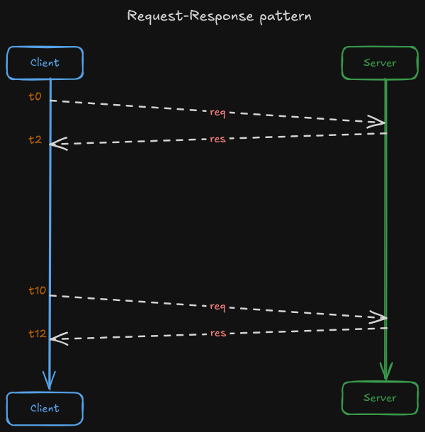

# Request–Response Communication Pattern

## 1. What is Request–Response?

Request–Response is a communication pattern where a client sends a request to a server, the server processes it, and returns a corresponding response.

**Basic flow:**

`Client → Request → Server → Processing → Response → Client`

The client expects a result from the server before proceeding with operations that depend on that result.

## 2. Request–Response Is Almost Everywhere

Request–Response is one of the most fundamental communication patterns in software engineering. It is not limited to frontend-backend communication; it exists across almost every layer of a software system.

| Communication              | Example                 |
| -------------------------- | ----------------------- |
| Frontend ↔ Backend         | HTTP API requests       |
| Backend ↔ Database         | SQL queries and results |
| Backend ↔ Cache            | Redis GET/SET commands  |
| Service ↔ Service          | Internal API calls      |
| Client ↔ DNS Resolver      | Domain name resolution  |
| Service ↔ Remote Procedure | RPC / gRPC calls        |

**The common idea:** Different technologies and protocols, but the same fundamental interaction:

`Request → Processing → Response`

## 3. Understanding Time and Latency

Request–Response communication is not instantaneous. Both network transmission and processing introduce delays.

### Request lifecycle

- **T0 — Request initiation:** Client constructs, serializes, and sends the request.
- **T1 — Server processing:** Server receives the request, validates it, executes business logic, and potentially communicates with databases or external services.
- **T2 — Response received:** Server sends the result back, and the client receives and handles it.

### Request–Response Diagram

**Understanding the timeline:**

- T0 → T2: First request–response interaction.
- T10 → T12: Second request–response interaction.
- The timestamps are illustrative, not fixed durations.

**Important concepts:**

- **Latency:** Delay involved in communication or processing.
- **RTT (Round-Trip Time):** Time between sending a request and receiving its response.
- **Processing Time:** Time spent executing the operation on the server.

Simplified model:

`Total Time ≈ Request Transmission + Server Processing + Response Transmission`

In practice, connection setup, queuing, serialization, and other overheads can also contribute.

## 4. Advantages

- **Simplicity:** Straightforward communication model and implementation.
- **Immediate feedback:** Client receives the operation's result.
- **Predictability:** Clear request-response lifecycle and API contracts.
- **Debuggability:** Individual requests can be traced using logs and correlation IDs.
- **Broad ecosystem:** Supported by HTTP, REST, GraphQL, RPC, and gRPC.
- **Natural CRUD fit:** Excellent for operations that require immediate results.

## 5. Disadvantages

- **Network latency:** Every remote interaction introduces communication overhead.
- **Temporal coupling:** Both parties generally need to be available simultaneously.
- **Synchronous dependencies:** A caller must wait for results before continuing dependent operations.
- **Availability dependency:** Failure of a downstream service can affect the caller.
- **Cascading failures:** Synchronous service dependencies can propagate failures.
- **Long-running operations:** Requests may exceed client, server, or proxy timeouts.
- **Scalability challenges:** High request volumes can increase resource consumption and downstream pressure.

## 6. Reliability Considerations

When implementing request–response communication in distributed systems, consider:

- **Timeouts:** Avoid waiting indefinitely for a response.
- **Retries:** Retry transient failures with exponential backoff and jitter.
- **Idempotency:** Prevent duplicate side effects when requests are retried.
- **Circuit Breakers:** Stop repeatedly calling unhealthy services.
- **Correlation IDs:** Trace requests across multiple services.
- **Rate Limiting:** Protect services from excessive traffic.

## 7. When to Use It?

Use Request–Response when the caller needs a direct result.

| Use case                              | Example                          | Technologies commonly used                                       |
| ------------------------------------- | -------------------------------- | ---------------------------------------------------------------- |
| Authentication and authorization      | Login, token validation          | HTTP, OAuth 2.0, OpenID Connect, gRPC interceptors               |
| Fetching user or product information  | Profile pages, search            | HTTP/REST, GraphQL, gRPC                                         |
| CRUD operations                       | Create/read/update/delete records | REST, GraphQL mutations, gRPC                                    |
| Payment authorization                 | Approve or decline a charge      | HTTPS payment APIs (Stripe, PayPal), 3-D Secure                  |
| Retrieving account balances           | Balance inquiries                | REST/GraphQL queries, SQL, Redis GET                             |
| Synchronous service-to-service calls  | Internal APIs between services  | gRPC, REST, Apache Thrift                                        |

For long-running or background operations, consider asynchronous alternatives such as Message Queues, Publish–Subscribe, and Event-Driven Architecture.

## 8. Key Takeaways

- Request–Response is a communication pattern, not a protocol.
- It is used throughout software systems, not just between frontend and backend.
- Network latency and processing time directly affect response time.
- Synchronous dependencies introduce temporal and availability coupling.
- Timeouts, retries, and idempotency are essential reliability considerations.
- Request–Response is ideal for direct interactions, but asynchronous messaging is often better for decoupled background processing.
