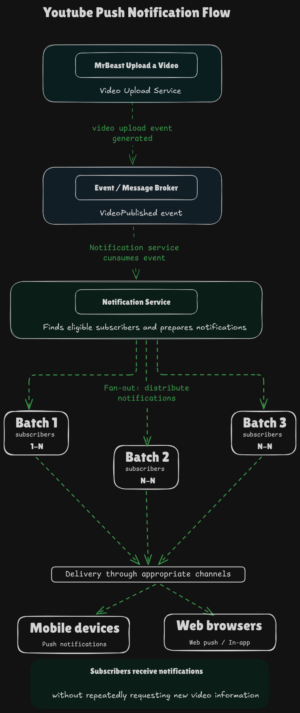

# Push Communication Pattern

## 1. What is the Push Pattern?

It is a communication pattern in which a sender actively sends data or events to a receiver without waiting for the receiver to request them.

In simple terms:

Imagine subscribing to a YouTube channel. Whenever that creator uploads a new video, YouTube can notify you automatically. You don't need to open YouTube every five minutes and ask:

_"Has this creator uploaded a new video?"_

Instead, YouTube initiates the notification and delivers it to you.

**The fundamental idea: The sender decides when to send; the receiver doesn't have to ask.**

## 2. Real-world example: Youtube Notification system

Let's understand Push through a more interesting scenario. Imagine MrBeast uploads a new video on YouTube.

Assume:

- MrBeast has 100 million subscribers.
- 100 million subscribers are eligible to receive notifications.
- A large number of subscribers are currently online.
- MrBeast uploads a new video.

**The challenge:** How does YouTube notify millions of subscribers without requiring them to constantly check whether a new video exists?

### Step by Step communication flow



_Note: This is a conceptual architecture illustrating how a large-scale video notification system could work, not a disclosure of YouTube's exact internal implementation._

### What happens behind the scenes?

#### Step 1: Video upload

MrBeast uploads a video. YouTube's video processing infrastructure handles the upload, encoding, storage, and publication.

#### Step 2: Event generation

After the video is published, the system generates an event:

```json
{
  "event": "VIDEO_PUBLISHED",
  "channelId": "mrbeast",
  "videoId": "video_123",
  "publishedAt": "2026-11-18T10:00:00Z"
}
```

#### Step 3: Event distribution

The event is sent to a messaging infrastructure. A notification service consumes it and identifies subscribers who are eligible for notifications.

#### Step 4: Fan-out

The system distributes notification work across multiple workers instead of making one server handle all 100 million subscribers.

For example:

- Worker 1 processes subscriber batch A.
- Worker 2 processes subscriber batch B.
- Worker 3 processes subscriber batch C.
- Thousands of workers could operate concurrently.

#### Step 5: Notification delivery

Notifications are delivered through the appropriate mechanisms, such as mobile push services, web push, or in-app connections.

#### Step 6: Subscriber receives notification

The subscriber sees something like:

> **MrBeast uploaded:** _I Built 100 Wells in Africa!_

The important part is that the subscriber didn't have to request this update.

---

## 3. Understanding Fan-out: The Important Concept

When dealing with millions of receivers, simply pushing messages one by one from a single server is not a scalable approach.

This is where **Fan-out** becomes important.

Fan-out means distributing one event to multiple receivers or downstream consumers

### Why is fan-out necessary?

Suppose one worker takes 10 milliseconds to process a notification.

For 100 million subscribers:

```text
100,000,000 × 10ms = 1,000,000 seconds
```

That's approximately 11.57 days if processed sequentially!

Now, if 10,000 workers process batches concurrently, the theoretical processing time becomes much smaller, although real-world performance depends on network latency, database access, rate limits, and delivery-provider capacity.

This is why distributed processing is essential for large-scale push systems.

## 4. Where Does Push Shine Best?

Push is particularly useful when the receiver needs to know about an event as soon as possible.

| Scenario                   | Why Push is useful                          | Technologies commonly used                                                             |
| -------------------------- | ------------------------------------------- | -------------------------------------------------------------------------------------- |
| Messaging applications     | Deliver messages immediately                | WebSockets, MQTT, Firebase Cloud Messaging (FCM), APNs                                 |
| Social media               | Notify followers about new posts            | WebSockets, Server-Sent Events (SSE), Pub/Sub (Kafka, Redis Pub/Sub)                   |
| E-commerce                 | Notify customers about order status changes | Webhooks, Web Push (W3C Push API), FCM, APNs, SNS                                      |
| Banking                    | Alert customers about transactions          | APNs, FCM, SMS gateways, WebSockets                                                    |
| Stock trading              | Deliver price and market updates            | WebSockets, SSE, MQTT, low-latency Pub/Sub (Kafka, Aeron)                              |
| Multiplayer games          | Synchronize real-time game events           | WebSockets, UDP-based protocols, MQTT, WebRTC (data channels)                          |
| Monitoring systems         | Alert engineers when infrastructure fails   | Webhooks, PagerDuty/Alertmanager events, Kafka, Redis Pub/Sub, SSE                     |
| Collaborative applications | Broadcast changes to connected users        | WebSockets, SSE, CRDT sync over WebSockets (e.g. Yjs, Automerge), Google Docs-style OT |
