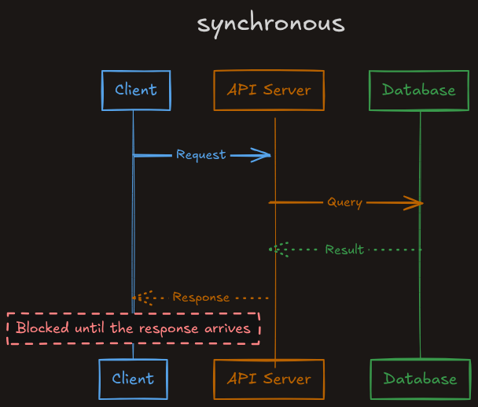
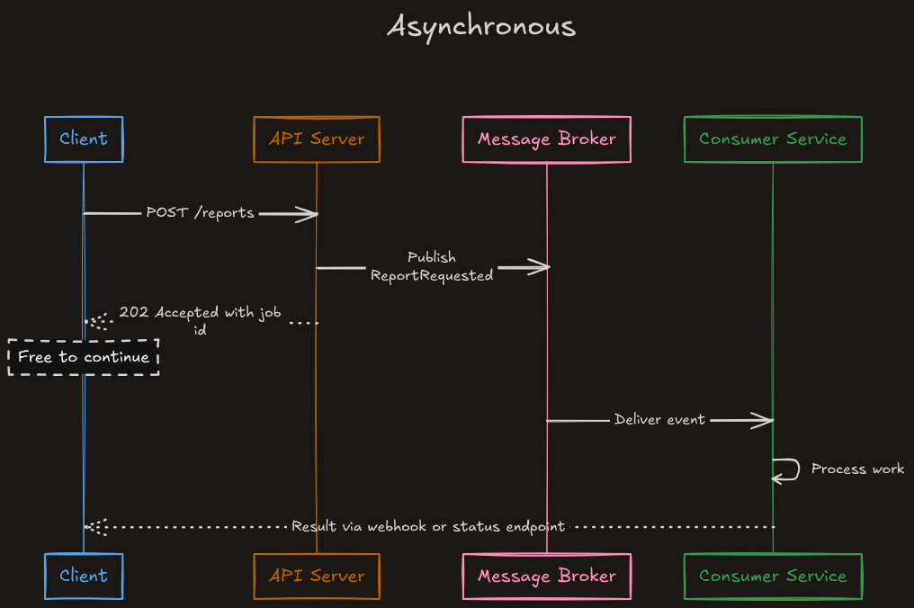
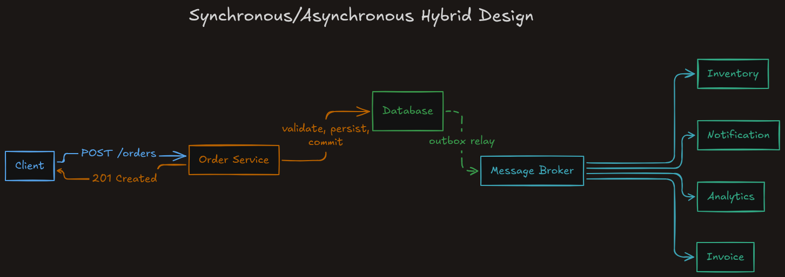

# Synchronous vs Asynchronous Communication

## 1. Definitions

**Synchronous:** the caller sends a request and waits for the receiver to finish and respond before proceeding. The caller is temporally coupled to the receiver.
*Example:* a payment service processes a transaction and returns success or failure while the user waits.

**Asynchronous:** the caller initiates work and continues without waiting for it to complete. The result, if needed, arrives later via callback, event, webhook, or a polling endpoint.
*Example:* an order service accepts an order and publishes an event. Inventory, email, and invoicing consume it independently.

**Not the same as blocking vs non-blocking.** Sync/async describes *coordination between components*. Blocking/non-blocking describes *how a runtime waits on I/O*. A Node service that `await`s an HTTP response is non-blocking at the runtime level but still synchronous at the communication level, because the caller's logic cannot proceed without the answer.

## 2. Relationship to Other Communication Patterns

Sync/async is orthogonal to request-response and push.

- **Request-response vs push** is about *who initiates* the exchange.
- **Sync vs async** is about *whether the caller waits* for completion.

| | Sync | Async |
|---|---|---|
| **Request-response** | `GET /balance`, caller blocks on the answer | `POST /reports` returns `202 Accepted`, result via polling or webhook |
| **Push** | Rare, e.g. a server calling a client and waiting on its reply | Server-sent events, WebSocket messages, webhooks, broker delivery |

Request-response can be async: a `202 Accepted` plus a status endpoint or webhook decouples completion from the request. Push is usually async, but the push itself is not what makes it async. The sender not waiting for the receiver to process is.


## 3. Flows

### Synchronous



### Asynchronous



## 4. Comparison

| Dimension | Synchronous | Asynchronous |
|---|---|---|
| Coupling | Temporal coupling to the receiver | Decoupled in time |
| Response | Result or error, immediately | Acknowledgment first, result later |
| Latency | Includes all downstream work | Initial response is fast; end-to-end completion is not |
| Failure behavior | Downstream failures propagate to the caller | Failures are isolated, but must be handled via retries, DLQs, compensation |
| Consistency | Immediate consistency at the operation boundary is easy | Typically eventual |
| Load handling | Spikes hit downstream directly | Queues buffer spikes |
| Complexity | Simple to reason about and debug | Needs idempotency, ordering strategy, tracing, retry policy |

Async does not automatically buy reliability, availability, or consistency. Those depend on the broker's guarantees and how you build producers and consumers. An acknowledgment also means "accepted," not "processed."

## 5. Where Each Fits

**Synchronous:** authentication, balance checks, payment validation, reads, and any transaction where the caller's next decision depends on the result.

**Asynchronous:** emails and SMS, video or image processing, report and invoice generation, analytics ingestion, search index updates, and fan-out to multiple consumers.

## 6. Why Commit Is Usually Synchronous

A user transfers NPR 1,000 from Account A to Account B. The application debits A, credits B, commits, and waits for the commit result before reporting anything.

If the app reported success before the commit was durable and the database then crashed, the user would be told money moved when it didn't. The commit acknowledgment is what lets the app make a truthful claim.

Caveat: "durable" is configuration-dependent (fsync settings, replication mode, synchronous vs asynchronous replicas). A commit ack confirms the guarantees *your* database is configured to give.

Async still has a role here: after the commit succeeds, notifications, analytics, and history projections can be driven by published events.

## 7. Hybrid Design (What Production Looks Like)



Solid edges to the client and database are synchronous. Everything leaving the broker is asynchronous.

Order acceptance is synchronous because the customer needs a durable confirmation. Everything downstream is asynchronous because it can proceed independently.

The hard part is publishing the event reliably. If you commit and then publish, a crash between the two loses the event. The **transactional outbox** pattern fixes this: write the event to an outbox table in the same transaction as the order, then a relay publishes it. This gives at-least-once delivery, so **consumers must be idempotent**.

## 8. Technologies

| Style | Technologies | Note |
|---|---|---|
| Synchronous | HTTP/REST, gRPC, GraphQL, database drivers | Request-response |
| Asynchronous | Kafka, RabbitMQ, SQS, Redis Streams | Brokers with different guarantees: Kafka is a replayable log, RabbitMQ and SQS are queues with routing and acks |

These are not interchangeable. Pick based on delivery semantics, ordering, retention, and replay needs.

## 9. Runtime Examples: Node.js and Go

**Node.js**

```javascript
const fs = require("fs");

// Blocking: the event loop is stuck until the read completes
const data = fs.readFileSync("hello.txt", "utf8");

// Non-blocking: the read is delegated, the callback runs later
fs.readFile("hello.txt", "utf8", (err, data) => {
  if (err) throw err;
  console.log(data);
});
console.log("runs before the file contents");
```

Blocking the event loop stalls every concurrent request, which is why `readFileSync` is acceptable at startup but a bug in a request handler.

**Go**

```go
var wg sync.WaitGroup
wg.Add(1)

go func() {
    defer wg.Done()
    data, err := os.ReadFile("hello.txt") // blocks this goroutine only
    if err != nil {
        log.Println(err)
        return
    }
    fmt.Println(string(data))
}()

fmt.Println("main continues")
wg.Wait()
```

Go has no separate async file API. `os.ReadFile` blocks its goroutine, and the scheduler runs other goroutines meanwhile. Concurrency comes from cheap goroutines rather than from non-blocking call signatures.

## 10. Takeaways

1. Sync means waiting for the response. Async means continuing without it.
2. Neither is inherently better. Choose based on whether the caller's next step depends on the result.
3. Async trades simplicity for decoupling: you take on retries, idempotency, ordering, observability, and eventual consistency.
4. Commit acknowledgment is synchronous by design, within the durability you configured.
5. Real systems are hybrid: synchronous at the decision boundary, asynchronous for the fan-out.

**The goal is not to make everything asynchronous. It is to make each interaction synchronous or asynchronous for a reason you can defend.**